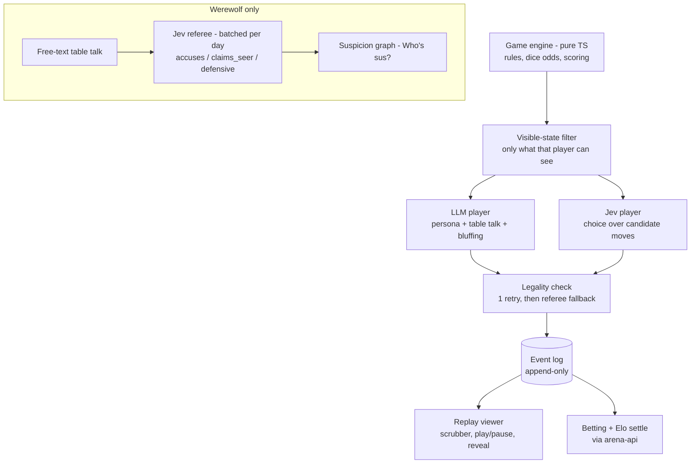

# Agent Arena

Watch AI players face off in **Liar's Dice** and a 5-player **Werewolf Lite**, bet fake points on who wins, and scrub through replays. LLM players think out loud and bluff in character. **Jev** (TypeSafe AI's fast decision model) plays as its own fast player by picking from the legal moves, and also acts as the **referee** that turns free-text table talk into structured votes and accusations.

**Code runs the game, Jev picks and referees, the LLMs talk and bluff.**

## How it works



### Why a fast choice model makes a good game player and referee

- **As a player**: Liar's Dice decisions are a bounded choice — call liar or one of at most 8 candidate bids. A fast choice model evaluates exactly those options (with true binomial odds attached) and returns an answer in milliseconds, at a fraction of the cost of a general text model. That makes high-frequency game loops affordable.
- **As a referee**: Werewolf table talk is free text, but the game needs structure: who is accusing whom, who claims to be the seer, who is defending. One batched Jev request per day round converts every statement into structured answers (`accuses`, `claims_seer`, `defensive`) that power the suspicion graph — without ever deciding the votes themselves.

## Architecture

- `src/engine/` — pure TypeScript game engine, unit-test friendly, **no AI inside**:
  - `dice.ts` — Liar's Dice (2–4 players, 5 dice each, ones are wild). `legalMoves`, `candidateMoves` (≤ 8: call_liar + top-7 bids by odds), `bidOdds` (Binomial, p = 1/3 counting wilds), challenge resolution and dice removal.
  - `werewolf.ts` — Werewolf Lite (1 werewolf, 1 seer, 3 villagers). Night: wolf picks a victim, seer checks a player. Day: statements (≤ 280 chars), then votes. Max 4 day rounds.
  - `events.ts` — every action appends `{t, actor, type, payload, visible_to}`, which drives the live view and replays.
- `src/lib/` — client orchestration:
  - `matchRunner.ts` — drives matches, asks each seat for a move (LLM / Jev / mock), validates legality (**one retry**, then referee fallback marked `forfeit_move`), appends events.
  - `mockPlayer.ts` — scripted bots per persona driven by `bidOdds` thresholds and canned table talk (used when no OpenAI key is configured).
  - `bets.ts` — bet placement, Elo-style odds, pairwise multi-player Elo updates (K = 24).
- `supabase/functions/` — exactly **3 edge functions**, all secrets server-side only:
  1. `llm-player` — LLM persona moves (`OPENAI_API_KEY`, optional `OPENAI_BASE_URL`, `OPENAI_MODEL`; no `temperature` is sent). Returns `{move, table_talk, private_reasoning}`; the move must be in the legal list.
  2. `jev` — TypeSafe AI `systemone`, model pinned to `jev-1.13.0`. Retries 429/529 with exponential backoff, measures latency, computes cost as `input_tokens * 0.042 / 1M` USD (output tokens free). Player mode: one choice question over `m0…m7` candidate moves. Referee mode: one batched request per day round with `p{idx}__{q}` question IDs.
  3. `arena-api` — no AI. Saves matches + events, places and settles bets, updates ratings (the client never writes `ratings` directly), enforces the daily cap counters.

## Daily usage cap

Every paid upstream request (each attempt, retries included) is counted in `usage_counters(day, fn, calls)` via the service-role-only `increment_usage_counter` RPC, right before the fetch inside `llm-player` and `jev`. Above **200 calls/day per function** (override with the `DAILY_CALL_LIMIT` secret) they return HTTP 429 `{error:"daily_limit"}`; if the counter can't be read they fail closed with 503. The match keeps running: Jev seats fall back to the best-odds move and LLM seats take the referee fallback move.

If the OpenAI key is missing, matches run with **Mock players** (scripted persona bots). Jev still runs live in mock mode when its key exists.

## Setup

```bash
# 1. Configure secrets (server-side only, never in the browser)
supabase secrets set TYPESAFE_API_KEY=... OPENAI_API_KEY=...

# 2. Deploy the edge functions
supabase functions deploy llm-player
supabase functions deploy jev
supabase functions deploy arena-api

# 3. Run locally
npm install
npm run dev
```

## Environment variables

| Variable | Where | Purpose |
| --- | --- | --- |
| `TYPESAFE_API_KEY` | Supabase secret | Jev (player + referee) API key |
| `OPENAI_API_KEY` | Supabase secret | LLM persona players (falls back to mock bots if absent) |
| `OPENAI_BASE_URL` | Supabase secret (optional) | Override OpenAI-compatible endpoint |
| `OPENAI_MODEL` | Supabase secret (optional) | Model id (default `gpt-6-luna`) |
| `DAILY_CALL_LIMIT` | Supabase secret (optional) | Paid upstream calls per function per UTC day (default `200`) |
| `VITE_SUPABASE_URL` | client env | Supabase project URL |
| `VITE_SUPABASE_ANON_KEY` | client env | Supabase anon key (public reads via RLS; all writes go through `arena-api`) |

## Screenshots

| Lobby | Table | Replay |
| --- | --- | --- |
|  |  |  |

## Design decisions

1. **Rules in code.** The engine is deterministic plain TypeScript with no AI: challenges, dice removal, vote tallies, and win conditions are all resolved by code, so results are verifiable and replays are exact.
2. **Visible-state filtering.** Every AI request receives only what that seat can legitimately see (own dice, public bids; own role, public statements). The filter lives in the engine, not in prompts.
3. **At most 8 candidate moves.** `candidateMoves()` trims the full move list to call_liar plus the 7 most plausible bids ranked by binomial odds, keeping Jev's choice questions small and fast.
4. **Batched referee calls.** One Jev request per day round covers every statement (`p{idx}__{q}` namespacing) instead of one call per statement — 3 statements per day means a 3x cost and latency reduction.
5. **Daily cap.** 200 calls/day per function protects against runaway loops; the UI degrades gracefully into replay mode.
6. **3 functions only.** All AI traffic goes through `llm-player` and `jev`; all database-privileged operations (settlement, ratings) go through `arena-api` so the browser never holds privileged credentials.
